<div align="center">

#  FOOD DELIVERY DATA ANALYSIS

### From Raw Data to Actionable Business Insights

**A Practical Data Analytics Project | Python · Pandas · NumPy · Data Visualization**

Exploring food delivery operations through structured data cleaning, exploratory analysis, and meaningful visualizations.

<br>


<br>


</div>

---

# 📌 01. Project Overview

Food delivery platforms operate in a dynamic environment where delivery performance can be influenced by traffic conditions, weather, distance, vehicle types, and order characteristics.

But what does the data actually reveal about these factors?

This project explores a food delivery dataset containing **45,584 records and 20 columns** to understand operational patterns, improve data quality, and investigate relationships between different variables and delivery duration.

The project follows a structured, week-by-week analytical workflow — beginning with data understanding and cleaning, followed by exploratory data analysis and visualization.

### 🎯 Project Objectives

- Understand the structure and quality of operational data.
- Identify and handle missing values and duplicate records.
- Standardize inconsistent date and time information.
- Prepare a reliable dataset for further analysis.
- Explore delivery-time distributions and patterns.
- Investigate relationships between operational factors and delivery duration.
- Communicate findings through clear visualizations.

---

# 📂 02. Dataset Overview

| Dataset Attribute | Details |
|---|---|
| Dataset Name | Food Delivery Dataset |
| Original Records | 45,584 |
| Total Features | 20 |
| File Format | CSV |
| Data Type | Structured Tabular Data |
| Domain | Food Delivery Operations |
| Primary Tools | Python, Pandas, NumPy |

### Key Dataset Features

The dataset contains information about:

- Delivery personnel age and ratings
- Restaurant and delivery location coordinates
- Order dates and timings
- Weather conditions
- Road traffic density
- Vehicle conditions and types
- Order categories
- Festival information
- Delivery duration

---

# 🚀 03. Project Journey

## ✅ WEEK 01 — Data Understanding & Cleaning

<sub>PHASE 01 · DATA PREPARATION</sub>

**Objective:** Transform raw delivery records into a structured and analysis-ready dataset.

### 3.1 Data Understanding

- Loaded and inspected the original CSV dataset.
- Examined dataset dimensions, column names, and data types.
- Generated descriptive statistical summaries.
- Explored numerical and categorical variables.
- Reviewed the structure and quality of the available data.

### 3.2 Data Quality Assessment

Systematic checks were performed to identify:

- Missing values across columns.
- Duplicate records.
- Unusual numerical observations.
- Inconsistent categorical values.
- Date and time formatting issues.

### 3.3 Data Cleaning Operations

| Data Quality Issue | Cleaning Approach |
|---|---|
| Missing delivery age | Median imputation |
| Missing delivery ratings | Median imputation |
| Missing delivery count | Median imputation |
| Selected missing categorical values | Replaced with `Unknown` |
| Decimal-based time values | Converted to HH:MM format |
| Selected pickup times beyond midnight | Normalized to next-day clock time |
| Missing order times | Retained without guessing |

Unusual numerical observations were inspected and retained where their meaning could not be established reliably from the available documentation.

### 3.4 Cleaning Results

| Metric | Result |
|---|---:|
| Original Records | 45,584 |
| Cleaned Records | 45,584 |
| Total Columns | 20 |
| Rows Removed | 0 |
| Duplicate Rows | 0 |
| Cleaning Log Entries | 16 |
| Remaining Missing Values | 1,731 |

### Important Data Quality Decision

The remaining 1,731 missing values belong to the `Time_Orderd` column.

These values were intentionally retained because their actual order times could not be reliably determined. This avoids introducing unsupported assumptions into the dataset.

### 3.5 Validation & Export

- Compared original and cleaned dataset dimensions.
- Verified duplicate records after cleaning.
- Reviewed remaining missing values.
- Exported the cleaned dataset as a CSV file.
- Reloaded the exported file to validate its structure.
- Maintained a separate cleaning log.

### Week 1 Deliverables

- Data understanding and cleaning notebook
- Data quality assessment
- Cleaned food delivery dataset
- Cleaning log
- Validation and export verification

📓 **Notebook:** `notebooks/01_data_understanding_and_cleaning.ipynb`

📁 **Cleaned Dataset:** `data/processed/cleaned_food_delivery.csv`

📄 **Cleaning Log:** `docs/cleaning_log.csv`

---

## 📊 WEEK 02 — Exploratory Data Analysis (EDA)

<sub>PHASE 02 · EXPLORATION & VISUALIZATION</sub>

**Objective:** Explore the cleaned dataset, identify patterns, and investigate factors associated with food delivery performance.

EDA helps transform a cleaned dataset into meaningful analytical questions and visual insights.

### 3.6 Analytical Questions

- How is delivery time distributed?
- How does road traffic relate to delivery duration?
- Do weather conditions show differences in delivery time?
- How does calculated delivery distance relate to delivery duration?
- Are multiple deliveries associated with longer delivery times?
- How do delivery ratings relate to delivery duration?
- What patterns can be explored across cities and vehicle types?

---

# 📈 04. Visual Analytics Gallery

The following visualizations were generated from the project's cleaned dataset.

Each chart explores a different dimension of food delivery operations.

## A. Delivery Time Analysis

### 01. Delivery Time Distribution

<p align="center">
  <a href="visualizations/delivery_time_distribution.png">
    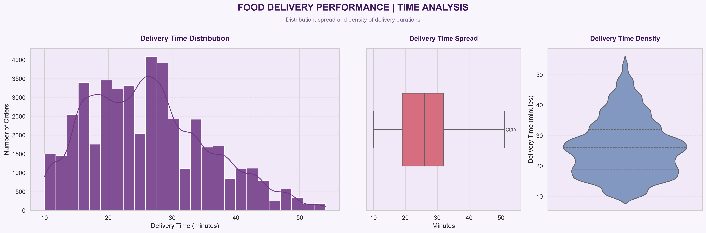
  </a>
</p>

<p align="center">
  <sub>Understanding the distribution of delivery durations across orders.</sub>
</p>

### 02. Delivery Time Boxplot

<p align="center">
  <a href="visualizations/delivery_time_boxplot.png">
    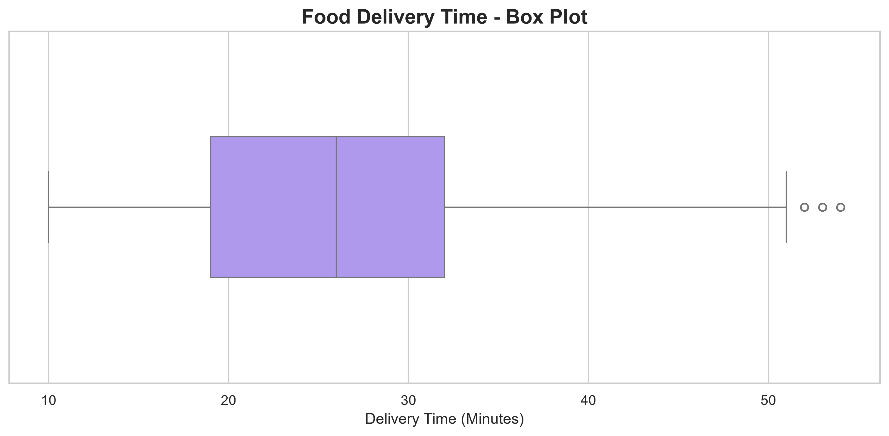
  </a>
</p>

<p align="center">
  <sub>Examining the spread and potential outliers in delivery duration.</sub>
</p>

---

## B. Operational Conditions Analysis

### 03. Traffic Conditions vs Delivery Time

<p align="center">
  <a href="visualizations/traffic_vs_delivery_time.png">
    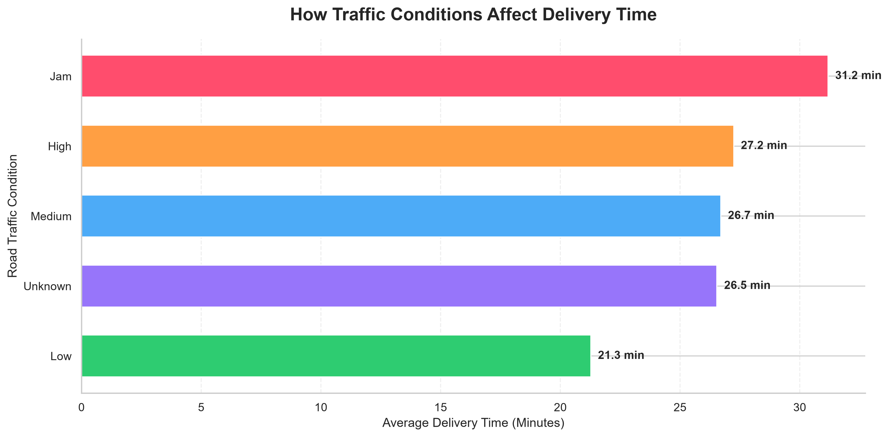
  </a>
</p>

<p align="center">
  <sub>Comparing delivery duration across different road traffic conditions.</sub>
</p>

### 04. Weather Conditions vs Delivery Time

<p align="center">
  <a href="visualizations/weather_vs_delivery_time.png">
    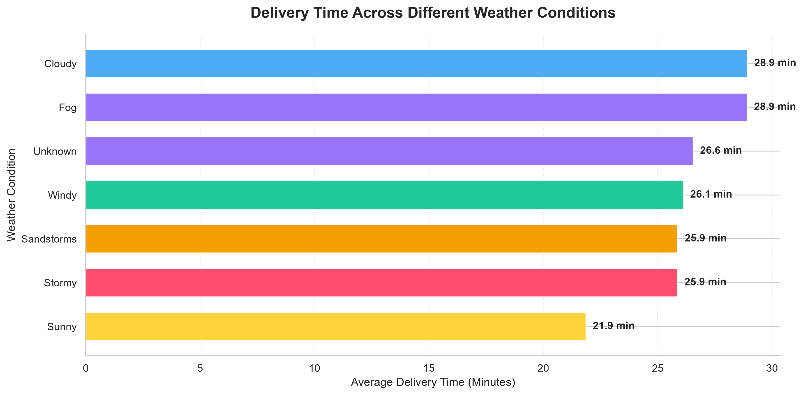
  </a>
</p>

<p align="center">
  <sub>Exploring delivery-time patterns across different weather conditions.</sub>
</p>

### 05. Vehicle Type vs Delivery Time

<p align="center">
  <a href="visualizations/vehicle_vs_delivery_time.png">
    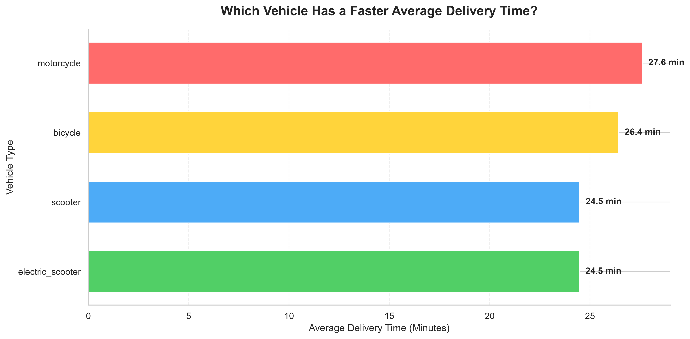
  </a>
</p>

<p align="center">
  <sub>Comparing delivery duration across vehicle categories.</sub>
</p>

### 06. Multiple Deliveries vs Delivery Time

<p align="center">
  <a href="visualizations/multiple_deliveries_vs_time.png">
    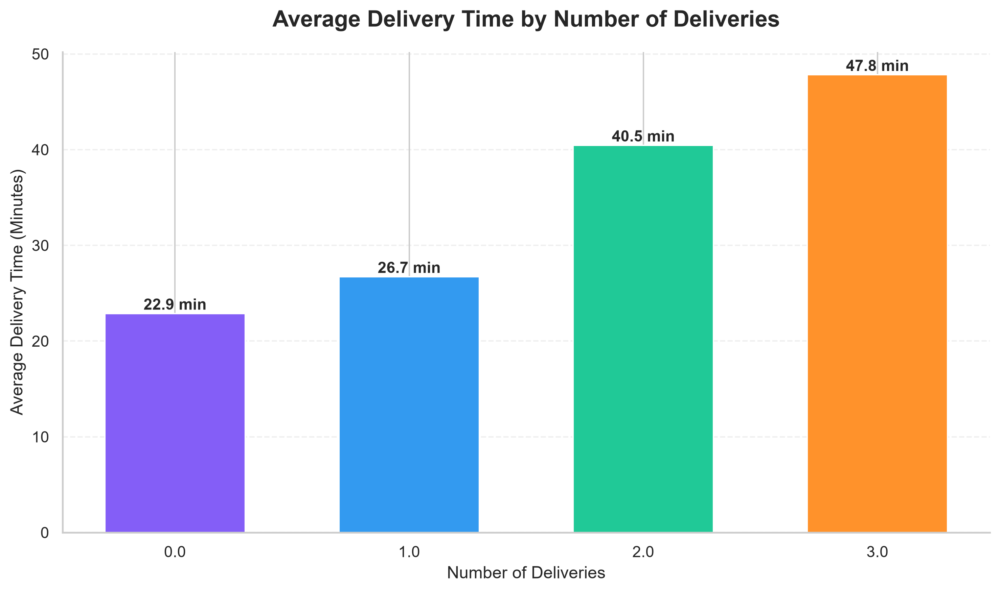
  </a>
</p>

<p align="center">
  <sub>Investigating delivery-time patterns across multiple-delivery categories.</sub>
</p>

---

## C. Distance, Ratings & Order Timing

### 07. Distance vs Delivery Time

<p align="center">
  <a href="visualizations/distance_vs_delivery_time.png">
    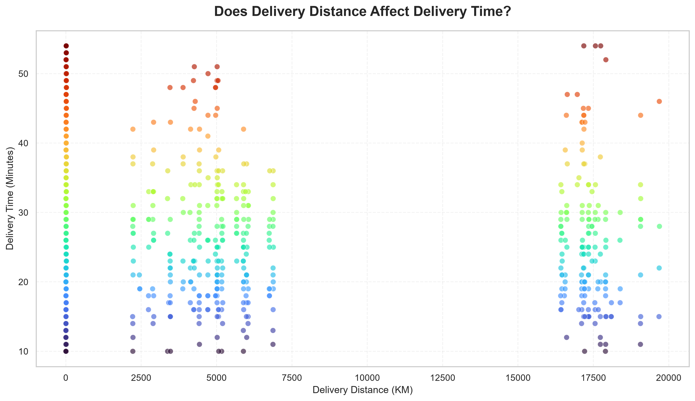
  </a>
</p>

<p align="center">
  <sub>Investigating the relationship between calculated delivery distance and duration.</sub>
</p>

### 08. Ratings vs Delivery Time

<p align="center">
  <a href="visualizations/ratings_vs_delivery_time.png">
    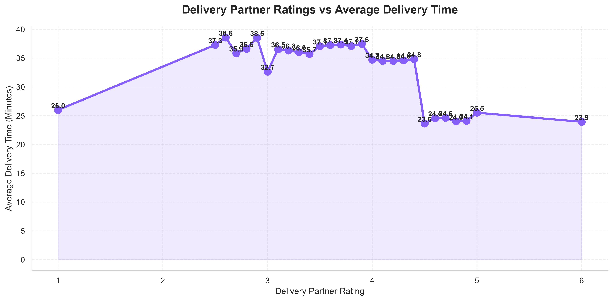
  </a>
</p>

<p align="center">
  <sub>Exploring the association between delivery ratings and delivery duration.</sub>
</p>

### 09. Order Time vs Delivery Time

<p align="center">
  <a href="visualizations/order_time_vs_delivery_time.png">
    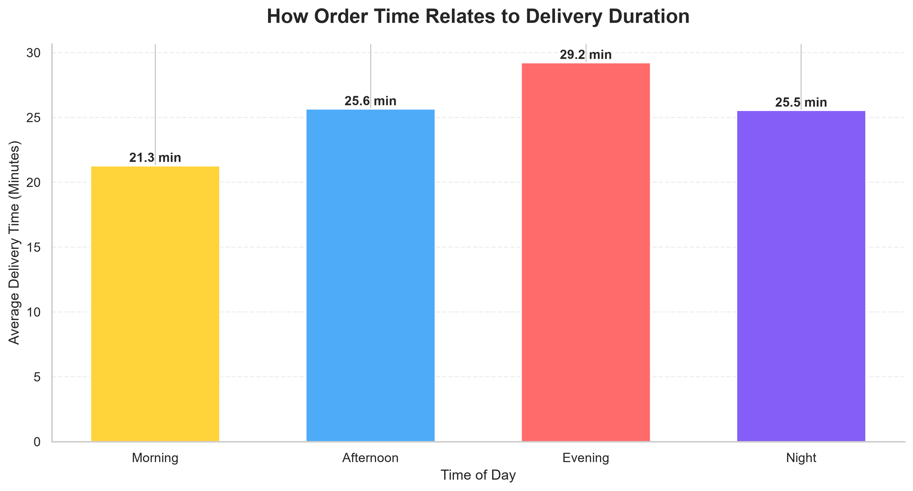
  </a>
</p>

<p align="center">
  <sub>Exploring how order timing relates to delivery duration.</sub>
</p>

---

## D. City-Level Analysis

### 10. City vs Delivery Time

<p align="center">
  <a href="visualizations/city_vs_delivery_time.png">
    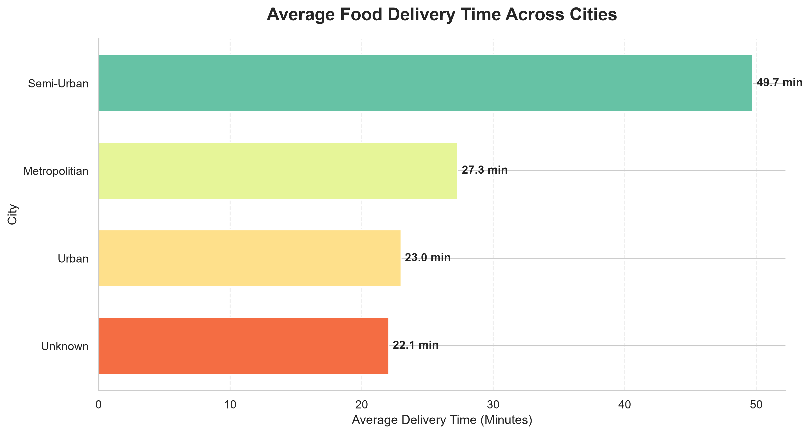
  </a>
</p>

<p align="center">
  <sub>Comparing delivery-time patterns across cities.</sub>
</p>

### 11. City-wise Order Distribution

<p align="center">
  <a href="visualizations/city_order_distribution.png">
    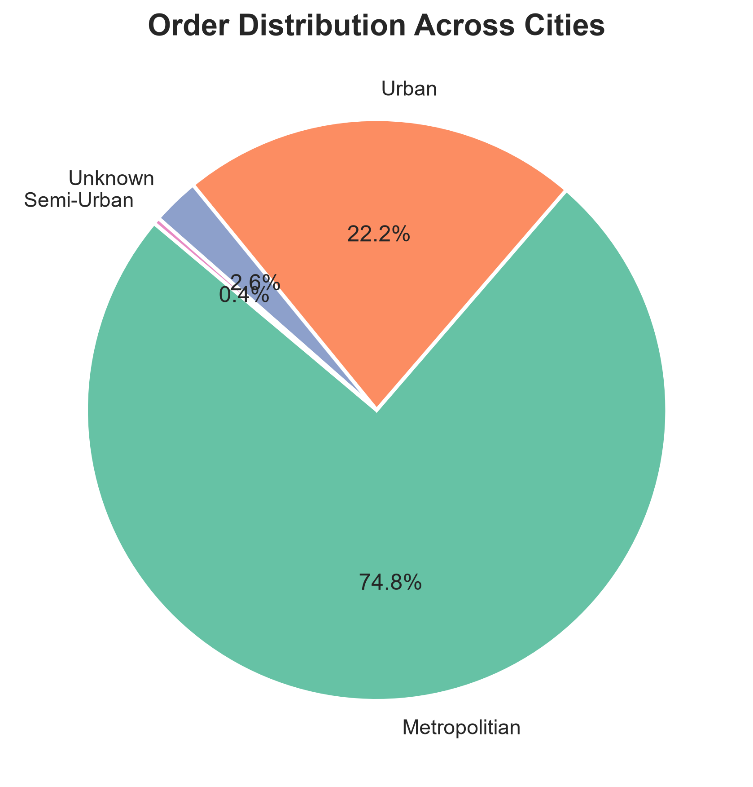
  </a>
</p>

<p align="center">
  <sub>Exploring how orders are distributed across city categories.</sub>
</p>

---

## E. Correlation Analysis

### 12. Correlation Heatmap

<p align="center">
  <a href="visualizations/correlation_heatmap.png">
    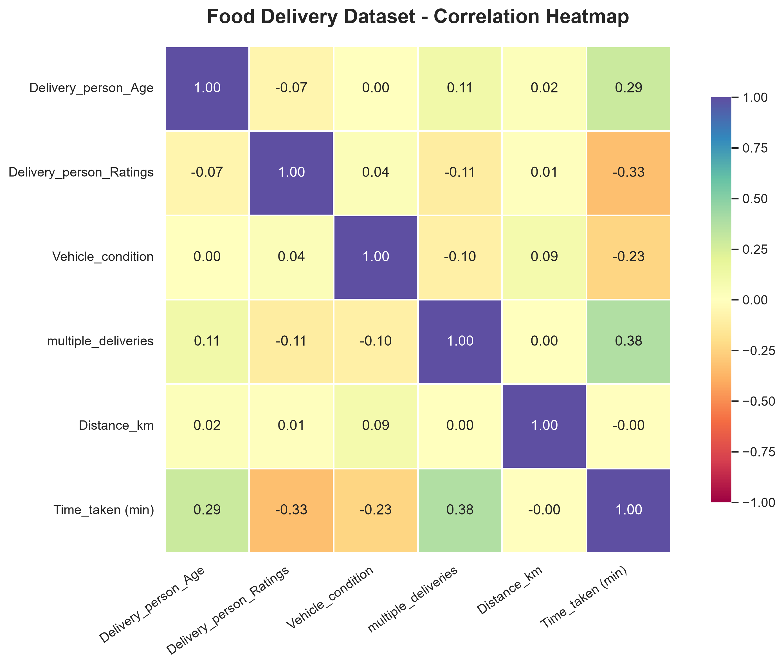
  </a>
</p>

<p align="center">
  <sub>Visualizing relationships between numerical variables in the dataset.</sub>
</p>

---

# 🔎 05. Key Analytical Findings

The following correlation results were obtained during the exploratory analysis.

| Relationship | Correlation |
|---|---:|
| Distance vs Delivery Time | -0.003 |
| Ratings vs Delivery Time | -0.331 |

### What Do These Results Suggest?

**Distance vs Delivery Time (-0.003)**

The calculated straight-line distance has almost no linear correlation with delivery duration in this dataset.

**Ratings vs Delivery Time (-0.331)**

Ratings show a negative association with delivery duration. This relationship does not establish that delivery time causes a change in ratings.

> **Analytical Note:** Distance was calculated using the Haversine formula from the available coordinates. It represents straight-line distance, not actual road travel distance. Correlation indicates association, not causation.

---

### Week 2 Deliverables

- Exploratory Data Analysis notebook
- Delivery-time distribution analysis
- Traffic and weather comparisons
- Vehicle and multiple-delivery analysis
- Distance and ratings analysis
- City-wise operational analysis
- Correlation heatmap
- 12 visualization outputs

📓 **Notebook:** `notebooks/02_exploratory_data_analysis.ipynb`

📁 **Visualizations:** `visualizations/`

---

# 🛠️ 06. Technology Stack

| Technology | Purpose |
|---|---|
| Python | Core programming language |
| Pandas | Data manipulation and analysis |
| NumPy | Numerical operations |
| Matplotlib | Data visualization |
| Seaborn | Statistical visualization |
| Jupyter Notebook | Interactive analysis |

---

# 📁 07. Repository Structure

```text
food-delivery-data-analysis/
│
├── data/
│   ├── raw/
│   │   └── README.md
│   │
│   └── processed/
│       └── cleaned_food_delivery.csv
│
├── notebooks/
│   ├── 01_data_understanding_and_cleaning.ipynb
│   └── 02_exploratory_data_analysis.ipynb
│
├── docs/
│   └── cleaning_log.csv
│
├── visualizations/
│   ├── city_order_distribution.png
│   ├── city_vs_delivery_time.png
│   ├── correlation_heatmap.png
│   ├── delivery_time_boxplot.png
│   ├── delivery_time_distribution.png
│   ├── distance_vs_delivery_time.png
│   ├── multiple_deliveries_vs_time.png
│   ├── order_time_vs_delivery_time.png
│   ├── ratings_vs_delivery_time.png
│   ├── traffic_vs_delivery_time.png
│   ├── vehicle_vs_delivery_time.png
│   └── weather_vs_delivery_time.png
│
├── README.md
└── requirements.txt
```

---

# 💻 08. Installation & Setup

Follow these steps to run the project locally.

### Step 1 — Clone the Repository

```bash
git clone https://github.com/ayushi857-dev/food-delivery-data-analysis.git
```

### Step 2 — Navigate to the Project Directory

```bash
cd food-delivery-data-analysis
```

### Step 3 — Install Dependencies

```bash
pip install -r requirements.txt
```

### Step 4 — Launch Jupyter Notebook

```bash
jupyter notebook
```

Start with:

`notebooks/01_data_understanding_and_cleaning.ipynb`

Then explore:

`notebooks/02_exploratory_data_analysis.ipynb`

### Dataset Access

To execute the notebooks from scratch, place the original dataset at:

`data/raw/Food delivery Dataset.csv`

Refer to `data/raw/README.md` for dataset access instructions.

---

# 📚 09. Learning Outcomes

Through this project, I developed practical experience in:

- Understanding real-world structured datasets.
- Identifying and handling data-quality issues.
- Applying missing-value treatment techniques.
- Using Pandas for data preparation and exploration.
- Exploring numerical and categorical variables.
- Creating meaningful data visualizations.
- Interpreting correlation and statistical relationships.
- Documenting analytical decisions.
- Building reproducible data analysis workflows.

---

# 🔮 10. Future Scope

The project can be extended through:

- Deeper statistical analysis and hypothesis testing.
- Delivery performance segmentation.
- Identification of operational bottlenecks.
- Interactive dashboards for business reporting.
- Predictive modeling for delivery-time estimation.
- Machine learning-based delivery-time prediction.

---

# 👩‍💻 11. Author

<div align="center">

## Ayushi Shukla

**Aspiring Data Analyst | AI/ML Enthusiast**

[](https://github.com/ayushi857-dev)

[View Project Repository](https://github.com/ayushi857-dev/food-delivery-data-analysis)

<br>

**Built with Python, curiosity, and a data-driven mindset.**

*Learning · Exploring · Analyzing · Improving*

</div>
